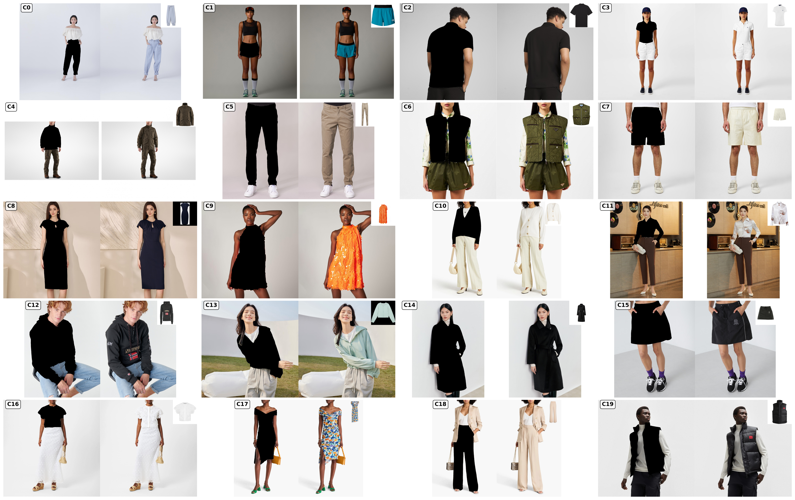

<div align="center">

# 👕 OpenVTON-Bench
**A Large-Scale High-Resolution Benchmark for Controllable Virtual Try-On Evaluation**

<p align="center">
  <a href="https://arxiv.org/abs/2601.22725">
    
  </a>
  <a href="https://huggingface.co/datasets/RenxingIntelligence/OpenVTON">
    
  </a>
  <a href="https://www.python.org/">
    
  </a>
  <a href="https://developer.nvidia.com/cuda-downloads">
    
  </a>
  <a href="LICENSE">
    
  </a>
</p>

*A comprehensive multi-modal evaluation protocol using VLM-based scores and multi-scale representation metrics.*

<p align="center">
  <a href="#-overview">Overview</a> •
  <a href="#-dataset">Dataset</a> •
  <a href="#-evaluation-protocols">Evaluation</a> •
  <a href="#-installation">Installation</a> •
  <a href="#-quick-start">Quick Start</a> •
  <a href="#-citation">Citation</a>
</p>
</div>

---

## 🔍 Overview

**OpenVTON-Bench** is a **large-scale, high-resolution benchmark** designed for the **systematic evaluation of controllable virtual try-on (VTON) models**.

Unlike existing datasets and evaluation protocols that struggle with texture details and semantic consistency, OpenVTON-Bench provides:

- 🖼️ **~100K Image Pairs**: Breathtaking resolutions up to **1536×1536** to evaluate fine-grained texture generation.
- 🏷️ **Fine-Grained Taxonomy**: Semantically balanced across **20 garment categories**.
- 📐 **Multi-Level Automated Evaluation**: Comprehensively covering:
  - Pixel fidelity
  - Garment consistency
  - Semantic realism

This benchmark enables **fair, reproducible, and scalable comparison** across modern diffusion-based and transformer-based try-on systems.

---

## 🧬 Data Construction Pipeline

<div align="center">
  
</div>
<br>

The dataset is constructed through a rigorous **three-stage pipeline** ensuring category diversity, visual quality, and semantic consistency:

1. 🌐 **Web-Scale Crawling**: With strict resolution filtering to maintain commercial-grade quality.
2. ✍️ **Hybrid Annotation**: Combining human verification with Vision-Language Model (VLM) dense captioning.
3. ⚖️ **Semantic-Aware Balancing**: Utilizing **DINOv3** hierarchical clustering for uniform distribution.

---

## 📦 Dataset

### 🔗 HuggingFace Access
The full dataset is open-source and publicly available on HuggingFace:

> [!IMPORTANT]
> 👉 **[RenxingIntelligence/OpenVTON Dataset](https://huggingface.co/datasets/RenxingIntelligence/OpenVTON/)**

### 📊 Statistics

| Property | Value | Description |
| :--- | :--- | :--- |
| **Image Pairs** | `~100,000` | High-quality garment and person pairs |
| **Resolution** | Up to `1536×1536` | Critical for fine-grained texture assessment |
| **Categories** | `20` | Fine-grained garment taxonomy |
| **Annotation** | Hybrid | VLM dense captioning + human verified |

---

## 👗 Garment Categories

<div align="center">
  
  <p><em>Samples from the 20 garment categories (C0–C19) included in OpenVTON-Bench.</em></p>
</div>

---

## 📊 Evaluation Protocols

OpenVTON-Bench introduces a **hybrid evaluation paradigm** featuring four complementary protocols. This multi-view design captures **both perceptual and structural quality** of generated try-on results:

| Type | Description | Key Metrics |
| :--- | :--- | :--- |
| 🧠 **VLM-based** | Semantic realism via Vision-Language Models (VLM-as-a-Judge) | Background, Identity, Texture, Shape, Overall |
| ✂️ **Garment-based** | Region-level evaluation via [SAM3](https://github.com/facebookresearch/sam3) | SSIM, PSNR, LPIPS, Cosine |
| 🖼️ **All-based** | Full-image feature comparison using [DINOv3](https://github.com/facebookresearch/dinov3) | SSIM, LPIPS, Cosine |
| 👾 **Pixel-based** | Raw pixel structural comparison | MSE, PSNR, SSIM, LPIPS, FID |

### 🧮 Evaluation Metrics Guide

| Metric | Goal | Description |
| :--- | :---: | :--- |
| **SSIM** | **↑** Higher | Structural Similarity Index |
| **PSNR** | **↑** Higher | Peak Signal-to-Noise Ratio |
| **Cosine Sim** | **↑** Higher | Feature-level cosine similarity |
| **LPIPS** | **↓** Lower | Learned Perceptual Image Patch Similarity |
| **FID** | **↓** Lower | Fréchet Inception Distance |
| **MSE** | **↓** Lower | Mean Squared Error |

> [!NOTE]
> **VLM evaluation** utilizes a **1–5 scoring scale** across five semantic dimensions (Background, Identity, Texture, Shape, and Overall realism).

---

## 🛠 Installation

### Requirements

- Python **3.12+**
- CUDA **12.4+**
- *Recommended: **4× GPUs** for large-scale evaluation*

### Setup Environment

1. **Clone the repository:**
   ```bash
   git clone https://github.com/RenxingIntelligence/OpenVTON-Bench.git
   cd OpenVTON-Bench
   ```

2. **Create and activate the environment:**
   Using `conda` (Recommended):
   ```bash
   conda env create -f env.yaml
   conda activate bench_new
   ```
   *Or using `pip`:*
   ```bash
   pip install -r requirements.txt
   ```

---

## 🚀 Quick Start

### 1. Download Required Models

Before running the benchmark, prepare the necessary backbone weights for feature extraction and segmentation in the `models/` directory:

```text
models/
 ├── dinov3-vith16plus/    # Feature extraction
 └── sam3/                 # Garment segmentation
```

### 2. Configure Paths

Copy the template configuration file:
```bash
cp benchmark/config.yaml benchmark/config.local.yaml
```

Update the configuration (`benchmark/config.local.yaml`) with your generated image directories and model paths:
```yaml
data:
  test_jsonl: "./data/test_samples.jsonl"
  generated_dirs:
    - name: "your_model"
      path: "./generated_images/your_model"

models:
  dinov3:
    path: "./models/dinov3-vith16plus"
```

### 3. Run Benchmark

Run the full benchmark suite:
```bash
bash run_benchmark.sh --config benchmark/config.local.yaml
```

**Or run specific evaluation types individually:**
```bash
bash run_benchmark.sh --eval-type pixel
bash run_benchmark.sh --eval-type garment
bash run_benchmark.sh --eval-type vlm
```

> [!WARNING]
> **Dataset Format Requirement:**
> The generated images must maintain identical filenames to the source/target images as specified in the JSONL:
> `{"source": "00001.jpg", "target": "00001.jpg"}`

---

## 📁 Output Structure

The benchmark automatically generates a rich suite of analytics, outputted to the `results/` directory:

```text
results/
 └── YYYYMMDD_HHMMSS/
     ├── summary.json          # Aggregate metric scores
     ├── per_model/            # Detailed model-specific data
     └── visualizations/       # Radar plots, comparison charts, per-sample diagnostics
```

## 📈 Correlation Analysis

To measure the agreement between our automated multi-modal metrics and human subjective evaluation:

```bash
python benchmark/analyze_correlation.py \
  --result_dir results/... \
  --human_ratings data/human.json
```

---

## 🧱 Project Structure

<details>
<summary><b>Click to expand</b></summary>

```text
benchmark/
 ├── metrics/                  # Implementation of all evaluation metrics
 ├── utils/                    # Helper scripts and visualizers
 ├── run_benchmark.py          # Main execution entrypoint
 └── analyze_correlation.py    # Statistical correlation tools
```
</details>

---

## 🧾 Citation

If you find this benchmark useful in your research, please consider citing:

```bibtex
@misc{li2026openvtonbenchlargescalehighresolutionbenchmark,
      title={OpenVTON-Bench: A Large-Scale High-Resolution Benchmark for Controllable Virtual Try-On Evaluation}, 
      author={Jin Li and Tao Chen and Shuai Jiang and Weijie Wang and Jingwen Luo and Chenhui Wu},
      year={2026},
      eprint={2601.22725},
      archivePrefix={arXiv},
      primaryClass={cs.CV},
      url={https://arxiv.org/abs/2601.22725}, 
}
```

---

## 📜 License

This project is licensed under the [MIT License](LICENSE).
